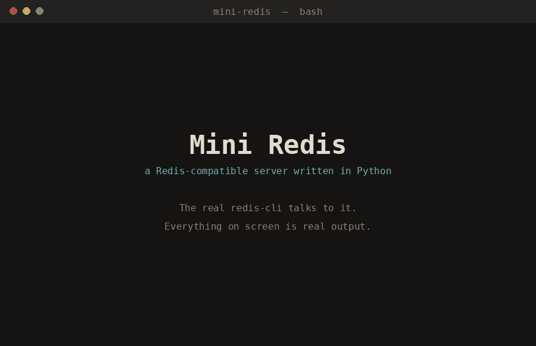
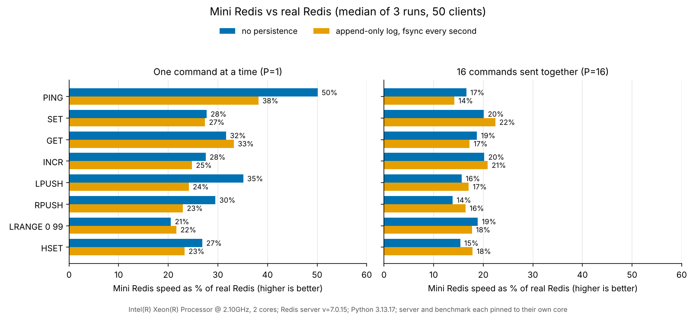

# Mini Redis

A small Redis-compatible server written in Python, built to learn how Redis works.
Real tools such as `redis-cli` can talk to it because it speaks the RESP protocol.



The demo above is real output, not a mock-up: `python make_demo_gif.py` starts the
server, runs the real `redis-cli` commands (including a `kill -9` and a restart),
captures what they print, and draws it as an animated terminal. `demo.sh` is the
same demo as a plain script, if you would rather record your own terminal.

## Run it

```
python server.py --port 6380
redis-cli -p 6380 PING        # -> PONG
```

On Ubuntu or WSL, install the Redis command-line client (you do not need to run
a separate Redis server):

```bash
sudo apt update
sudo apt install redis-tools
redis-cli --version
```

To keep your data across restarts, give it a log file:

```
python server.py --port 6380 --aof-file mini.aof
```

Options: `--appendfsync always|everysec|no` (default `everysec`, see
[Saving to disk](#saving-to-disk)) and `--max-query-buffer BYTES`.

## Run the tests

```
python -m unittest -v        # all tests, takes under 10 seconds
```

The tests that compare against real Redis (`test_compat.py`) and check the log with
`redis-check-aof` are skipped automatically when those tools aren't installed.

## Commands

| Command  | Notes |
|----------|-------|
| `PING [msg]` | |
| `SET key value [EX seconds \| PX ms \| PXAT unix-ms]` | wipes any old expiry, like Redis |
| `GET key` | nil if missing |
| `DEL key [key ...]` | returns how many were removed |
| `EXISTS key [key ...]` | returns how many exist |
| `EXPIRE key seconds` | zero or negative deletes the key |
| `PEXPIREAT key unix-ms` | an exact deadline; this is the form `EXPIRE` is saved in |
| `TTL key` | seconds left, `-1` no expiry, `-2` no such key |
| `INCR key` / `DECR key` | strict 64-bit integers, keeps the key's TTL |
| `LPUSH` / `RPUSH key value [value ...]` | returns the new length |
| `LRANGE key start stop` | negative indexes count from the end |
| `HSET key field value [field value ...]` | returns the number of new fields |
| `HGET key field` | |

Using a command on the wrong kind of value (for example `GET` on a list) returns
a `WRONGTYPE` error, as in real Redis.

## How it works

- `resp.py`: parses requests and encodes replies. Copes with commands that arrive
  in pieces, several commands arriving at once, and inline commands.
- `store.py`: the data and expiry logic.
- `commands.py`: one handler per command.
- `aof.py`: the append-only log (saving to disk and loading it back).
- `server.py`: the asyncio networking loop.

### Checked against real Redis

`compare_with_redis.py` sends the same ~300 commands to Mini Redis and to a real
Redis server and compares every reply byte for byte: error messages, edge cases
like `-0` or overflowing expiry times, wrong-type errors, and so on. `test_compat.py`
runs it as part of the test suite. Finding differences this way, instead of from
memory of how Redis behaves, is how the integer-parsing and expiry-range bugs were
found. The one known difference: `EXPIRE` and `PEXPIREAT` don't accept the
`NX`/`XX`/`GT`/`LT` options (Mini Redis answers with an argument-count error).

### Expiring keys

Deadlines are stored next to the keys, not as one timer per key. Two things remove
expired keys, the same way real Redis does it:

1. **Lazy:** every access checks the key's deadline first. An expired key is deleted
   and treated as if it never existed.
2. **Active:** once a second a background task samples keys that have deadlines and
   removes the expired ones. If more than a quarter of a sample was expired it
   samples again (up to 16 rounds), so one sweep can't hog the server.

Edge case decisions, each covered by a test:

- A key is expired when `now >= deadline`, and the check runs before the command acts.
  So a `SET` at the exact moment of expiry creates a fresh key with no TTL.
- `SET` clears the old TTL. `INCR` and `HSET` keep it.
- `DEL` and `EXISTS` never count an expired key.

Time-based tests use a fake clock, so they are exact and never sleep.

### Many clients at once

Every connected client gets its own coroutine on one `asyncio` event loop, the same
idea as Redis's single loop serving everyone in turn. This gives some useful
properties, each covered by a test in `test_concurrency.py`:

- **Commands never overlap.** Only one command runs at a time, so `INCR` from 50
  clients at once returns exactly 1..N with no lost or repeated numbers, and no
  locks are needed.
- **A slow client only slows itself.** A client that never reads its replies makes
  only its own coroutine wait (`drain()`); other clients are still answered.
- **Broken clients are survivable.** Clients that disconnect halfway through a
  command, send garbage, or promise a huge value and never finish are cleaned up
  without affecting anyone else. A client whose unfinished command grows past
  `--max-query-buffer` (default 1 GB) is dropped.
- Also tested: 150 idle connections, a 5 MB value, and 10,000 pipelined commands in
  one write.

The parser has its own tests (`test_resp.py`), including one that feeds every
possible partial prefix of a command and checks it reports "not complete yet".

The real `redis-benchmark` tool also runs against it cleanly with 50 and 200 clients,
with and without pipelining. Speed is covered in [Benchmarks](#benchmarks).

**Trade-off:** because one thread runs every command, one slow command delays all
clients. Real Redis has the same property, which is why its docs warn against
slow commands on big data.

### Saving to disk

With `--aof-file`, every change is appended to a file as a command, in the same RESP
format clients use (real Redis's own log is the same idea). At startup the file is
read back and the commands are run again, which rebuilds the data. Reads are not
logged, and neither are commands that failed. The log passes the real
`redis-check-aof` tool.

Three details make this correct, and each has tests that fail if it is broken:

1. **Absolute times.** `SET k v EX 10` is saved as `SET k v PXAT <exact time>`, and
   `EXPIRE` as `PEXPIREAT`. "10 seconds from now" replayed an hour later would be
   wrong. Time left after a restart is the real time left, and a key that expired
   while the server was off is gone.
2. **Expiry is logged as `DEL`.** If a key expires and is then re-created (say, a
   string that expires and then becomes a list), replay must not find the old key
   still there. While replaying, nothing is allowed to expire, because the log
   describes the past: a later command in the log may still change a key that the
   clock of *today* calls expired.
3. **A torn last command is ignored and cut off.** A crash or power cut can leave
   half a command at the end of the file. On startup the server ignores it, prints a
   warning, and removes it from the file, so the next write starts on a clean
   boundary instead of gluing onto the broken half. A test cuts a log at every
   possible byte, including the middle of a value that itself contains `\r\n`, and
   checks that exactly the complete commands come back.

Damage anywhere *except* the very end means data is genuinely lost or corrupt, so
the server refuses to start and leaves the file untouched, instead of quietly
loading part of it. The same applies to a logged command that fails when replayed.

A write is handed to the log **before** the client gets its reply. If the log can't
be written (disk full, say), the server stops instead of promising durability it
can't give; Redis behaves the same way under `appendfsync always`.

`--appendfsync` chooses how long a write can be lost if the *whole machine* loses
power. (Killing just the server program loses nothing in any mode, because the
bytes are already with the operating system. There is a test that does `kill -9`
under each mode.)

| Mode | Behaviour |
|------|-----------|
| `always` | fsync before every reply. Safest and slowest; it also pauses all clients while it waits for the disk. |
| `everysec` (default) | fsync about once a second, in a background thread. Lose at most about a second. |
| `no` | never fsync; the operating system decides. |

A property test also runs thousands of random commands (with time moving forward,
expiry, wrong-type errors, and restarts at random moments) and checks that the data
read back from the log is exactly what was in memory.

## Benchmarks

Measured with the real `redis-benchmark` tool against real Redis 7.0.15 on the same
machine (2 cores, shared cloud VM), 50 clients, median of 3 runs, each server on its
own CPU core. Requests per second, no persistence:



| Command | Real Redis | Mini Redis | Mini as % of real |
|---|---:|---:|---:|
| **One command at a time per client** | | | |
| PING | 96,500 | 48,400 | 50% |
| SET | 112,900 | 31,300 | 28% |
| GET | 102,500 | 32,400 | 32% |
| LPUSH | 94,000 | 33,000 | 35% |
| LRANGE 0 99 | 71,300 | 14,600 | 21% |
| **16 commands sent together (pipelined)** | | | |
| SET | 754,700 | 152,000 | 20% |
| GET | 854,700 | 160,300 | 19% |
| LPUSH | 1,030,900 | 161,400 | 16% |
| LRANGE 0 99 | 167,600 | 31,700 | 19% |

**Mini Redis runs at roughly 15-50% of real Redis's speed.** That is the expected
price of Python against C, and the gap is much larger than the noise on this machine
(run-to-run spread was often 10-30%). All commands, the append-only log setup, and
latencies are in [docs/BENCHMARK.md](docs/BENCHMARK.md).

**Profiling, then fixing.** Under `cProfile`, Mini Redis made one `socket.send` per
reply even when 16 commands arrived together; that was about 30% of its time, and
only about 20% went to running the commands. Sending all of a batch's replies in one
write (and logging a batch in one write) made pipelined workloads **3-4 times
faster**. It did nothing measurable for one-command-at-a-time traffic, which is what
the profile predicted. The before and after numbers, the profile, and why real Redis
is still ahead are in [docs/BENCHMARK.md](docs/BENCHMARK.md).

**Limits of this measurement:** one noisy 2-core VM, localhost only, and
`redis-benchmark` may limit real Redis's pipelined numbers, which would make the true
gap larger. Only the ratios would roughly carry over to another machine.

To run it yourself: `python bench.py` (about 5 minutes; needs `redis-server` and
`redis-benchmark`).

## Not built yet

- Log rewriting: the log only ever grows. Real Redis periodically rewrites it into
  the shortest list of commands that rebuilds the data (and can also save compact
  snapshots, called RDB).
- Many commands real Redis has (this is deliberately about 15)
- `SET` options `NX`, `XX`, `GET`, `KEEPTTL`; `EXPIRE` options `NX`, `XX`, `GT`, `LT`
- A limit on the number of connections (`maxclients`)
- A log that ends in zero bytes after a power cut (some filesystems do this) is
  treated as damaged and refused, not repaired
- The sweep builds a list of all keys with deadlines each time, which is fine here
  but would be too slow for millions of keys
- Speed work beyond the batching fix: cheaper parsing, skipping asyncio's stream
  layer, trying `uvloop` (the ideas, in order, are in [docs/BENCHMARK.md](docs/BENCHMARK.md))

## Roadmap

1. Basics (done)
2. Counters, expiry, lists, hashes (done)
3. Many clients at once (done)
4. Persistence with an append-only log (done)
5. Benchmark against real Redis, profile, fix the biggest cost, write up results (done)
